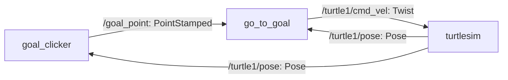

# 클릭한 좌표로 이동하는 ROS 2 turtlesim

ROS 2 Humble / Ubuntu 22.04 / Python. 별도 목표 지도 창에서 클릭하면 turtlesim의 거북이가 같은 좌표로 이동한다. 실제 거북이 창에 클릭하는 기능은 아니다.

## 빌드와 실행

```bash
source /opt/ros/humble/setup.bash
cd /home/tjsong12/ros2_ws
colcon build --symlink-install --packages-select turtle_click_nav
source install/setup.bash
ros2 launch turtle_click_nav click_nav.launch.py
```

새 터미널마다 `source /home/tjsong12/ros2_ws/install/setup.bash`가 필요하다. `/opt/ros/humble/setup.bash`는 ROS 자체를, workspace의 `install/setup.bash`는 직접 만든 패키지까지 찾아주게 한다.

창 3개가 열린다: turtlesim, Turtle Goal Map, rqt_graph. 목표 지도에서 클릭한다. 이동 중 다시 클릭하면 새 목표를 따른다. 목표까지 0.12 이내로 접근하면 정지한다. 벽에 붙는 목표를 피하도록 클릭 좌표를 0.5~10.5로 제한한다. Ctrl+C 또는 목표 지도/거북이 창 종료로 전체를 종료한다.

그래프 창만 끄고 실행하려면:

```bash
ros2 launch turtle_click_nav click_nav.launch.py show_graph:=false
```

## 조건과 노드 구조

필수 조건: turtlesim 사용, 노드 3개 이상과 토픽 발행/구독, launch 하나로 전체 실행.

| 노드 | 역할 | 구독 | 발행 |
|---|---|---|---|
| `/goal_clicker` | 클릭 → 목표 좌표, 현재 위치 표시 | `/turtle1/pose` | `/goal_point` |
| `/go_to_goal` | 목표와 현재 위치 비교 → 속도 | `/goal_point`, `/turtle1/pose` | `/turtle1/cmd_vel` |
| `/turtlesim` | 속도 명령으로 거북이 이동, 위치 제공 | `/turtle1/cmd_vel` | `/turtle1/pose` |

rqt_graph는 관찰용으로 추가되는 노드이며, 위 3개만으로 이미 필수 조건을 충족한다.



## 처음 알아야 할 개념

- 패키지: 코드, 의존성, 실행 설정을 묶은 ROS 배포/빌드 단위. 이 패키지는 실행 프로그램 2개를 제공하고, turtlesim 패키지의 프로그램 1개를 함께 실행한다.
- 노드: 실행 중인 역할 단위. 파일 개수와 노드 개수는 다르다.
- 토픽: 이름과 메시지 타입이 정해진 비동기 통신 채널. 발행자와 구독자의 토픽 이름과 타입이 맞아야 연결된다.
- 메시지: 토픽에 실리는 데이터 형식. `PointStamped`는 시각/좌표계/목표점, `Pose`는 현재 x/y/방향, `Twist`는 선속도/각속도다.
- launch: 여러 노드와 설정을 한 번에 실행하는 구성 파일. launch 자체가 이동 제어를 하지는 않는다.
- 콜백: 메시지가 도착하거나 타이머가 실행될 때 호출되는 함수. `on_goal`, `on_pose`, `control_step`을 보면 된다.

## 제어 원리와 읽을 순서

1. `goal_clicker.py`의 `on_click`: 화면 픽셀을 world 좌표로 변환하고 `PointStamped`를 발행한다. 화면은 아래로 갈수록 y가 커지므로 ROS 좌표로 바꿀 때 y를 뒤집는다.
2. `go_to_goal.py`의 `on_goal`, `on_pose`: 서로 다른 토픽으로 들어온 목표와 현재 위치를 저장한다.
3. `compute_velocity`: 아래 수식으로 속도를 계산한다.
4. `control_step`: 0.05초마다(20 Hz) 속도를 발행한다. 도착했거나 위치 메시지가 1초 넘게 오지 않으면 0을 발행한다.
5. `click_nav.launch.py`: 두 실행 파일과 turtlesim, rqt_graph를 함께 시작한다.

목표 오차: `dx = goal_x - x`, `dy = goal_y - y`

거리: `d = sqrt(dx² + dy²)`

목표 방향: `theta_goal = atan2(dy, dx)`

방향 오차: `e = atan2(sin(theta_goal - theta), cos(theta_goal - theta))`

이 각도 정규화는 ±π 경계에서도 가까운 방향으로 회전하게 한다. Pose.theta와 angular.z는 라디안 기준이다.

각속도: `w = clip(5.0 × e, -4.0, 4.0)`

선속도: `v = min(2.0, 1.2 × d) × max(0, cos(e))`

방향 오차가 60도를 넘으면 먼저 제자리 회전한다. 거리 0.12 이내에서는 v와 w를 모두 0으로 한다. 속도 상한을 두어 과도한 명령을 제한한다.

이것은 위치/방향 오차에 비례하는 **P 피드백 제어**다. 적분(I), 미분(D)항이 없으므로 PID라고 부르면 안 된다. 위치를 계속 다시 읽는 폐루프 제어이며, 미리 정한 시간 동안 전진하는 방식과 다르다. 별도 장애물 회피나 전역 경로 생성은 구현하지 않았다. 장애물이 없는 turtlesim에서 목표까지 직접 접근한다. 실제 로봇 적용 시 센서 오차, 장애물, 운동학, 통신 지연 등을 추가로 다뤄야 한다.

## rqt_graph 캡처

실행 후 목표를 한 번 클릭하고 rqt_graph에서 새로고침한다. 표시 모드를 `Nodes/Topics (all)`로 선택하고 필요하면 `Hide`의 `Dead sinks` / `Leaf topics` 필터를 해제한다. `/goal_clicker`, `/go_to_goal`, `/turtlesim`과 위 표의 3개 토픽이 보이도록 확대/정렬하여 캡처한다. ROS 기본 토픽(`/rosout`, `/parameter_events`)도 보일 수 있다.

## 직접 확인할 명령

다른 터미널에서 ROS/workspace 환경을 source한 뒤 실행한다.

```bash
ros2 node list
ros2 node info /go_to_goal
ros2 topic list -t
ros2 topic echo /goal_point
ros2 topic echo /turtle1/cmd_vel
ros2 topic hz /turtle1/pose
```

목표를 GUI 없이 발행해 제어부만 시험할 수도 있다.

```bash
ros2 topic pub --once /goal_point geometry_msgs/msg/PointStamped "{header: {frame_id: world}, point: {x: 8.0, y: 8.0, z: 0.0}}"
```

## 면접에서 설명하기

- 왜 3개 노드인가? 입력, 제어, 시뮬레이터 역할을 분리했다. 입력 GUI를 다른 입력 장치로 바꿔도 같은 목표 토픽을 발행하면 제어 노드를 재사용할 수 있다.
- 누가 움직이는가? 제어 노드가 Twist를 발행하고 turtlesim이 받아 이동을 시뮬레이션한다. GUI는 직접 속도를 보내지 않는다.
- 목표에 도달했는지 어떻게 아는가? 현재 Pose와 목표의 유클리드 거리를 매 주기 계산하여 허용 오차와 비교한다.
- 왜 정확히 0까지 가지 않는가? 이산 주기와 수치 오차로 목표 부근에서 계속 움직일 수 있어 허용 오차를 둔다.
- rqt_graph로 무엇을 증명하는가? 노드와 토픽의 연결을 확인한다. 올바른 좌표 도달까지 증명하지는 않으므로 실제 이동과 토픽 값도 함께 확인한다.
- 새로운 클릭이 들어오면? 저장된 목표를 교체하고 다음 제어 주기부터 새 목표를 따른다.

## 제출 체크

코드 실행과 캡처 준비 후, 공개 GitHub 저장소 링크 및 rqt_graph 캡처를 `이름_선택과제1.pdf`로 정리한다. README의 maintainer 이메일은 예시이므로 공개 제출 전 본인 정보로 수정한다. GitHub 업로드와 이메일 제출은 이 로컬 패키지에 포함된 동작이 아니다.
